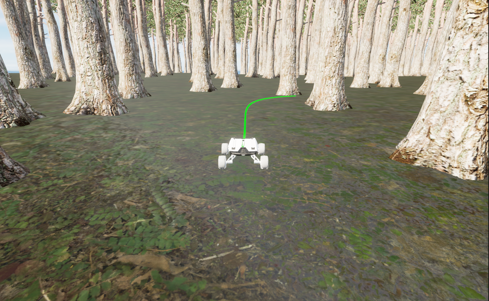
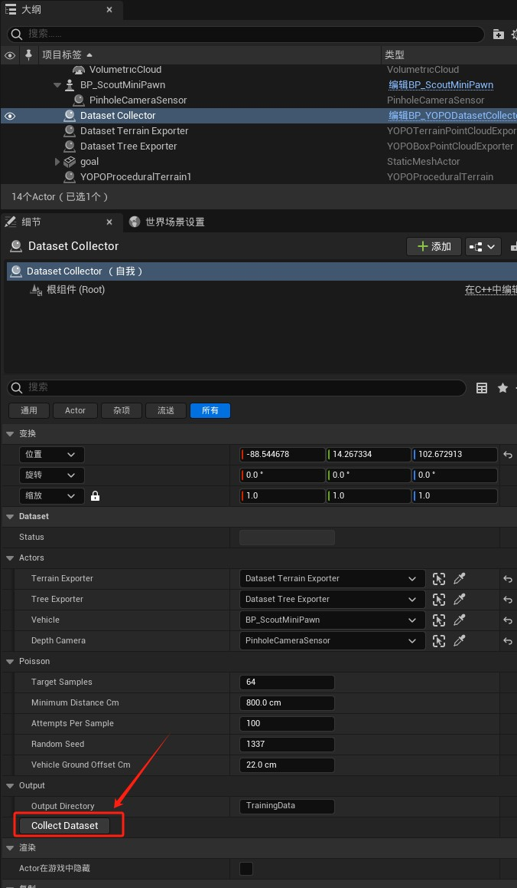

# YOPO-Rally 项目UE环境适配
目前该UE环境能用于YOPO-Rally推理，同时包含收集YOPO-Rally的数据集功能。

## Demo


## 快速开始
1. UE5环境配置
    本项目使用 Unreal Engine 5.0：

    ```bash
    git clone --recurse-submodules https://github.com/canyueduxuan/yopo_rally_ue.git yopo_rally_ue
    cd yopo_rally_ue
    ```

    如果已经用普通 `git clone` 下载项目，在项目根目录补充执行：

    ```bash
    git submodule update --init --recursive
    ```

    下载完成后，为 `yopo_rally_ue.uproject` 生成项目文件，编译并使用 UE 5.0 打开项目。
1. 配置[YOPO-Rally](https://github.com/TJU-Aerial-Robotics/YOPO-Rally.git)
    ```
    # 1. Clone the repository
    git clone https://github.com/TJU-Aerial-Robotics/YOPO-Rally.git --recursive

    # 2. Create virtual environment and install dependencies
    uv venv --system-site-packages
    uv sync

    # 3. Build ROS2 packages (DO NOT use --symlink-install)
    source .venv/bin/activate
    colcon build && source install/setup.bash
    ```
1. YOPO-Rally和UE5连接([rosbridge_suite](https://github.com/code-iai/ROSIntegration))
    ```
    source /opt/ros/humble/setup.bash
    mkdir -p ~/rosbridge_ws/src
    cd ~/rosbridge_ws/src
    git clone -b humble https://github.com/RobotWebTools/rosbridge_suite.git
    cd ..
    colcon build --symlink-install
    source ~/rosbridge_ws/install/setup.bash
    ros2 launch rosbridge_server rosbridge_websocket_launch.xml address:=0.0.0.0 port:=9090  bson_only_mode:=true url_path:=//
    ```
1. 启动YOPO-Rally算法
    ```
    ros2 launch diablo_ros_wrapper diablo_algorithm.launch.py odom_topic:=/odom depth_topic:=/camera/depth/image_raw
    ```

## 数据集收集

切换到`Maps/M_DataGenerationScene`关卡，大纲中选中DatasetCollector，在细节中点击Collect Dataset按钮。数据集收集的参数在编辑器细节中调整。数据集默认保存位置在`Saved/TrainingData`


## 关卡

| 关卡 | 说明 |
| --- | --- |
| `Maps/M_Forest` | YOPO-rally推理地图 |
| `Maps/M_DataGenerationScene` | YOPO-rally数据集收集地图 |

## 插件子模块配置（维护者）

以下配置只需由主仓库维护者执行一次。普通使用者按上面的快速开始克隆即可。

| 插件目录 | 仓库 |
| --- | --- |
| `Plugins/ROSIntegration` | https://github.com/code-iai/ROSIntegration |
| `Plugins/UE5ScoutMini` | https://github.com/canyueduxuan/UE5ScoutMini.git |
| `Plugins/UE5Sensors` | https://github.com/canyueduxuan/UE5Sensors.git |
| `Plugins/UE5YOPO` | https://github.com/canyueduxuan/UE5YOPO.git |

